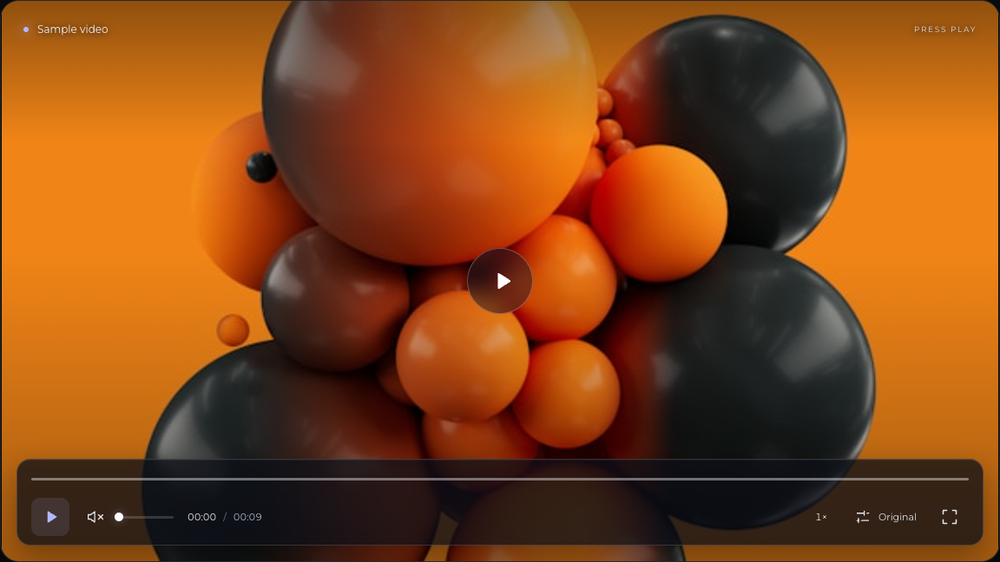

# FRAME / React Video Player

**Every frame. Nothing in the way.** A customizable, source-distributed video player
for Next.js App Router, strict TypeScript, and Tailwind CSS.


[Preview](#preview) · [Quick start](#quick-start) · [Integration](#use-in-your-nextjs-project) ·
[API](#component-api) · [Theming](#theming) · [Contributing](CONTRIBUTING.md)

## Preview

### Main player controls

[](docs/images/main-controls.png)

_Existing desktop capture. Open the image at full size to inspect the controls._

### Capture gallery

The remaining views are **planned captures**, with reserved relative paths below.
The links open instructions for each shot; images will appear here once captured.

| View                                                           | What to show                                           | Asset path                          | Status             |
| -------------------------------------------------------------- | ------------------------------------------------------ | ----------------------------------- | ------------------ |
| [Mobile / responsive](docs/screenshots.md#mobile--responsive)  | Portrait viewport with the full responsive dock        | `docs/images/mobile-player.png`     | Pending capture    |
| [Video quality menu](docs/screenshots.md#video-quality-menu)   | Open source / quality menu with the current selection  | `docs/images/quality-menu.png`      | Pending capture    |
| [Playback speed menu](docs/screenshots.md#playback-speed-menu) | All available rates and the selected speed             | `docs/images/speed-menu.png`        | Pending capture    |
| [Fullscreen mode](docs/screenshots.md#fullscreen-mode)         | Actual fullscreen playback with controls visible       | `docs/images/fullscreen-player.png` | Pending capture    |
| [Controls in motion](docs/screenshots.md#optional-animation)   | Play, scrub preview, menu selection, and idle controls | `docs/images/player-demo.gif`       | Optional recording |

<!-- Publish each image below only after its file exists, then update the status above.


-->

See the [screenshot capture guide](docs/screenshots.md) for viewport sizes,
repeatable states, export settings, and the publication checklist.

## Highlights

- Native MP4/WebM playback; native HLS when available, lazy-loaded `hls.js` otherwise.
- Floating glass dock, idle auto-hide, click feedback, real buffered ranges, supplied thumbnail cues.
- Typed callbacks, individual control toggles, scoped shortcuts, CSS tokens, and custom classes.
- Focus-aware auto-hide, keyboard menus, touch targets, and reduced-motion support.
- Interactive examples for MP4, HLS VOD, custom styling, and muted autoplay.

> **Distribution status:** this is a Next.js application with reusable source components,
> not a published npm library. The npm name `react-video-player` may belong to an unrelated
> package. The demo is configured for GitHub Pages at `/frame-player/`.

## Quick start

Requires **Node.js 22.12+**. Clone the repository and choose one package manager:

```sh
git clone https://github.com/LunaNezha/react-video-player.git
cd react-video-player

# npm: recommended, uses the committed lockfile
npm ci
npm run dev

# Or Yarn (creates its own lockfile)
yarn install
yarn dev

# Or pnpm (creates its own lockfile)
pnpm install
pnpm dev
```

Open **http://localhost:3000/frame-player**. Do not mix package managers within a checkout.
The playground mounts only the selected example. Live toggles change its controls;
the generated JSX reflects your choices (sample thumbnail cues omitted for readability).
The bundled HLS fixture is single-rendition VOD, not an adaptive ladder or live broadcast.

```sh
npm run build
# Serve the static export with any static HTTP server (output: out/).
# If your environment restricts Turbopack worker ports:
npm run build -- --webpack
```

### GitHub Pages media paths

`next.config.ts` defaults to `basePath: "/frame-player"`. The demo uses
`publicAsset()` for videos, posters, and thumbnails because raw HTML media URLs
need the same prefix. For example, `public/videos/sample-video.mp4` is requested
as `/frame-player/videos/sample-video.mp4`, not `/videos/sample-video.mp4`.
The reusable player accepts caller URLs unchanged, including external URLs.

To host at the domain root instead, build with `NEXT_PUBLIC_BASE_PATH="" npm run build`.
For another project path, set `NEXT_PUBLIC_BASE_PATH=/your-project` at build time.
Rebuild after changing this value; the path is embedded in the exported app.

Both bundled samples are 9.92-second, silent H.264 (`yuv420p`) videos; neither
contains an audio track. The HLS playlist references the five adjacent `.ts`
segments using relative URLs. No media re-encoding is needed for this path fix.
The deployed MP4, playlist, and segments should return `200` with `video/mp4`,
`application/vnd.apple.mpegurl`, and `video/mp2t`, respectively.

When playback fails, the player logs the browser's media error code/message,
resolved source URL, and network/readiness state to the console. Fatal HLS
errors log their type, details, and response. The player shows a readable alert
with **Try again**, which reloads the source and requests playback. Check the
Network panel for an HTML 404 response if a media URL reports a format error.

## Use in your Next.js project

This integration targets **Next.js App Router with React and Tailwind CSS 3**.
Standalone React packaging is not provided.

1. Copy `src/components/player`, `src/hooks`, `src/types`, `src/utils`, and
   `src/constants` into your project's `src`. Test files are optional.
2. Keep the TypeScript alias `@/*` → `./src/*`, or update the copied imports.
3. Install runtime helpers using one command:

   ```sh
   npm install hls.js clsx tailwind-merge
   # or: yarn add hls.js clsx tailwind-merge
   # or: pnpm add hls.js clsx tailwind-merge
   ```

4. Include `"./src/**/*.{js,ts,jsx,tsx,mdx}"` in your Tailwind `content` paths and
   retain its base/components/utilities directives in your global stylesheet.
5. Import `@/components/player/player.css` in your root layout **before** your global
   Tailwind stylesheet. This repo imports it from `globals.css`; do not import it twice.
6. Put your own media, poster, and preview images in `public`, or supply remote URLs.

`ProgressBar` uses unoptimized `next/image` thumbnails with `fill` inside a reserved
16:9 frame; no image optimization allowlist is required for them. Adapt the image component and styles before use
outside Next.js/Tailwind 3. No player styling is hidden inside the demo page.

### Standard implementation

```tsx
import { ReactVideoPlayer } from "@/components/player";

export default function Movie() {
  return (
    <ReactVideoPlayer
      src="/videos/movie.mp4"
      poster="/images/poster.jpg"
      title="My film"
      options={{ loop: false, muted: false, initialVolume: 0.6 }}
    />
  );
}
```

### Next.js App Router

The exported component already declares `"use client"`. A Server Component can render
it using serializable props. Put callbacks inside your own Client Component:

```tsx
// src/components/MovieExperience.tsx
"use client";

import { ReactVideoPlayer } from "@/components/player";
import type { ReactVideoPlayerOptions } from "@/components/player";

const options: ReactVideoPlayerOptions = {
  loop: false,
  controls: { quality: false },
  hotkeys: { fullscreen: "f" },
};

export function MovieExperience() {
  return (
    <ReactVideoPlayer
      src="/videos/movie.mp4"
      options={options}
      onEnded={() => console.info("Finished")}
      onTimeUpdate={(seconds, duration) => console.info(seconds, duration)}
    />
  );
}
```

```tsx
// src/app/layout.tsx
import "@/components/player/player.css";
import "./globals.css";
import type { ReactNode } from "react";

export default function RootLayout({ children }: { children: ReactNode }) {
  return (
    <html lang="en">
      <body>{children}</body>
    </html>
  );
}

// src/app/page.tsx (Server Component)
import { MovieExperience } from "@/components/MovieExperience";

export default function Page() {
  return (
    <main>
      <MovieExperience />
    </main>
  );
}
```

## Component API

Import components and all public types from `@/components/player`.
Options are grouped under `options`; callbacks and styling stay top-level.

| Prop         | Type                      | Default          | Description                                                                                            |
| ------------ | ------------------------- | ---------------- | ------------------------------------------------------------------------------------------------------ |
| `src`        | `string`                  | Required         | MP4, WebM, or HLS URL; local paths map to `public`.                                                    |
| `type`       | `VideoSource["type"]`     | Inferred         | Case-insensitive `.m3u8` → HLS, `.webm` → WebM, else MP4. Query/hash safe. Set for extensionless URLs. |
| `poster`     | `string`                  | Unset            | Poster image.                                                                                          |
| `title`      | `string`                  | `"Video player"` | Visible title and accessible region/video name.                                                        |
| `options`    | `ReactVideoPlayerOptions` | Below            | Playback and UI configuration.                                                                         |
| `className`  | `string`                  | Unset            | Extra root classes.                                                                                    |
| `classNames` | `PlayerClassNames`        | `{}`             | Additional `video`, `controls`, and `title` classes.                                                   |
| `theme`      | `PlayerTheme`             | Below            | Accent, radius, and glass opacity.                                                                     |
| `style`      | `PlayerStyle`             | Unset            | Root CSS plus `--player-*` variables; overrides `theme`.                                               |

### Options

| Option              | Type                                | Default          | Description                                                                                     |
| ------------------- | ----------------------------------- | ---------------- | ----------------------------------------------------------------------------------------------- |
| `autoPlay`          | `boolean`                           | `false`          | Requests playback on metadata load; browser policy applies.                                     |
| `muted`             | `boolean`                           | `true`           | Initial mute state; synchronized when changed.                                                  |
| `loop`              | `boolean`                           | `true`           | Repeat playback; set false to receive typical ended events.                                     |
| `initialVolume`     | `number`                            | `0.3`            | Volume clamped to 0–1; synchronized when changed.                                               |
| `showDuration`      | `boolean`                           | `true`           | Show elapsed and total time.                                                                    |
| `compact`           | `boolean`                           | `false`          | Reduce dock spacing.                                                                            |
| `controlsHideDelay` | `number`                            | `2800`           | Idle milliseconds, minimum 500. Paused/loading/error/focused states pin controls.               |
| `hotkeys`           | `false` or `Partial<PlayerHotkeys>` | Default bindings | Disable or override shortcuts.                                                                  |
| `controls`          | `PlayerControlsVisibility`          | All visible      | Optional booleans: `playPause`, `progress`, `volume`, `quality`, `playbackSpeed`, `fullscreen`. |
| `thumbnails`        | `readonly VideoThumbnail[]`         | Unset            | Caller-supplied `{ start, end, src }` cues in seconds. No runtime image generation.             |

Hiding controls removes only the UI, not shortcuts. Use `hotkeys: false` to disable
shortcuts. Clicking the video and center play button remain available. These are
configuration props, not a fully controlled playback-state API.

### Callbacks

All callbacks are optional, default to unset, and return `void`. Arguments are values,
**not React synthetic events**. Avoid expensive work in frequent time updates.

| Prop                   | Signature                                         | Trigger                                              |
| ---------------------- | ------------------------------------------------- | ---------------------------------------------------- |
| `onPlay`               | `() => void`                                      | Native play event.                                   |
| `onPause`              | `() => void`                                      | Native pause event.                                  |
| `onEnded`              | `() => void`                                      | Native ended event; normally requires `loop: false`. |
| `onTimeUpdate`         | `(currentTime: number, duration: number) => void` | Seconds; live durations may be non-finite.           |
| `onError`              | `(message: string) => void`                       | Media/HLS errors or rejected playback/fullscreen.    |
| `onSourceChange`       | `(source: VideoSource) => void`                   | Explicit selection in the advanced player.           |
| `onPlaybackRateChange` | `(rate: number) => void`                          | Playback-rate changes.                               |
| `onQualityChange`      | `(quality: VideoQuality \| null) => void`         | HLS manual selection; `null` means Auto.             |

### Multiple sources and HLS

The advanced `VideoPlayer` accepts a nonempty `sources` tuple, optional
`initialSourceId`, and the same configuration fields **directly**, not under `options`:

```tsx
import { VideoPlayer } from "@/components/player";
import type { VideoSource } from "@/components/player";

const sources = [
  { id: "1080", src: "/film-1080.mp4", type: "video/mp4", label: "1080p" },
  { id: "720", src: "/film-720.mp4", type: "video/mp4", label: "720p" },
] as const satisfies readonly [VideoSource, ...VideoSource[]];

export default function Film() {
  return <VideoPlayer sources={sources} loop={false} />;
}
```

For HLS use `<ReactVideoPlayer src="/stream/master.m3u8" />`. Quality choices come
from actual manifest levels; Auto delegates to `hls.js`. A single MP4 shows Original,
not invented resolutions. Native HLS leaves rendition selection to the browser.
Switching configured sources preserves position and playback state where possible.

## Theming

```tsx
<ReactVideoPlayer
  src="/movie.mp4"
  className="my-player"
  classNames={{ controls: "my-dock", video: "object-cover" }}
  theme={{
    primaryColor: "#6ee7b7",
    borderRadius: "28px",
    backgroundOpacity: 0.85,
  }}
  options={{ controls: { playbackSpeed: false }, controlsHideDelay: 3500 }}
/>
```

| CSS variable               | Default   | Purpose                          |
| -------------------------- | --------- | -------------------------------- |
| `--player-primary`         | `#b1b9ff` | Progress, focus, active accents. |
| `--player-radius`          | `22px`    | Container corners.               |
| `--player-surface-opacity` | `0.76`    | Glass opacity, 0–1.              |
| `--player-text`            | `#f4f5fa` | Primary text.                    |
| `--player-muted`           | `#b7bccb` | Secondary text.                  |

Set variables on a parent for shared theming, or through `style` for one instance.
Keep text contrast, focus indicators, and the responsive dock layout intact.

## Keyboard controls

Focus the player first. Shortcuts ignore editable fields, buttons, menus, and
modified key combinations. Bindings can be overridden with `options.hotkeys`.

| Key    | Action                                            |
| ------ | ------------------------------------------------- |
| Space  | Play / pause                                      |
| M      | Mute / unmute                                     |
| F      | Fullscreen                                        |
| ← / →  | Seek backward / forward 5 seconds                 |
| ↑ / ↓  | Volume up / down 5%                               |
| Escape | Close menus; fullscreen escape is browser-managed |

## Project structure

```text
src/
├── app/                       # Server layout/page; demo global styles
├── assets/fonts/              # Active local Montserrat font
├── components/
│   ├── demo/                  # Interactive client playground
│   └── player/
│       ├── index.ts           # Public exports and types
│       ├── ReactVideoPlayer.tsx # Simple src/options API
│       ├── VideoPlayer.tsx     # Multi-source composition
│       ├── player.css         # Separate reusable player styles
│       └── …                  # Buttons, menus, progress/volume controls
├── hooks/                     # HTML5/HLS playback and overlay state
├── types/                     # Public interfaces
├── utils/                     # Class merging and time formatting
└── constants/                 # Defaults, bindings, sample thumbnail cues
public/
├── images/                    # Poster and scrub-preview thumbnails
└── videos/                    # Sample MP4 and derived local HLS fixture
docs/
├── images/                    # README captures (kept out of public assets)
└── screenshots.md             # Capture recipes and publishing checklist
```

## Production considerations

- Serve media with appropriate MIME types, byte-range support, and caching. For
  cross-origin HLS, allow CORS on manifests **and** segments/keys. Configure CSP for
  your actual media/image origins and blob media/workers where `hls.js` uses them.
- Use HTTPS; validate codecs and browser/device support with your own streams.
  Fullscreen, autoplay, and programmatic volume vary, especially on mobile Safari.
  Muted inline autoplay is requested, not guaranteed; manual play remains available.
- Starting a second player pauses the previously active player.
- No DRM, authentication, backend analytics, live-edge/DVR controls, imperative ref,
  or caption-track UI is implemented. Add captions/equivalent accessible content
  before releasing speech-heavy media to audiences who need it.
- Browser APIs stay in client handlers/effects. Callbacks must not cross a Server
  Component boundary; use the client wrapper above.
- The inherited sample film's provenance is not established by this repository.
  Replace it with media you own or have redistribution permission for before release.

## Quality checks

```sh
npm run typecheck
npm run lint
npm run test.unit
npx prettier --check src docs README.md CONTRIBUTING.md
npm run build -- --webpack

# Watch unit tests while developing:
npm run test.unit:watch
```

CI runs type checking, lint, Jest unit tests, formatting, and a production build.
Tests use the Next.js compiler with Testing Library and jsdom, covering playback
state, public props and callbacks, HLS integration, menus, idle behavior, and previews.
No browser-test framework is installed. Manually verify mobile layout, real HLS/MP4
playback, autoplay policies, and browser-console warnings with your own media/CDN.

## Contributing & license

Focused pull requests, bug reports, and documentation improvements are welcome.
See [CONTRIBUTING.md](CONTRIBUTING.md) for setup, checks, and private security reporting.

Code is under the [MIT License](LICENSE), matching the project's existing declaration.
Dependencies and third-party media retain their own licenses. Review media rights
before redistributing the sample assets.
